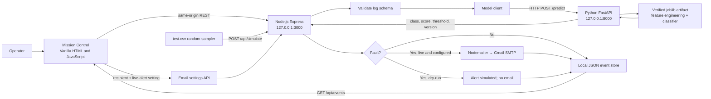

# Rogue Protocol Round 2 — System Architecture

## MVP scope

The current MVP accepts a log for classification, simulates bounded random rows from `test.csv`, records prediction outcomes locally, and can send SMTP email when live alerts are enabled. Simulation rows are test fixtures, not live vessel telemetry. SMTP acceptance is not proof of inbox delivery.

The browser UI is served by Node at `http://127.0.0.1:3000`. It calls the same origin, so no frontend API URL needs to be entered. Node calls the local Python model service at `http://127.0.0.1:8000` by default; override `MODEL_URL` only to use a different service. Node reads SMTP secrets from `round2-node/.env`; the recipient and live-alert setting are entered in Settings and kept in backend memory until restart.

## Architecture

## Request flow

1. On page load, the UI calls `GET /api/health`, `GET /api/events`, and `GET /api/email/settings` on its own origin.
2. `POST /api/predict` validates the submitted log, calls Python `/predict`, optionally dispatches email for a fault, then writes the event result to `round2-node/data/events.json`.
3. `POST /api/simulate` samples random rows from `test.csv`, runs model inference concurrently in batches, applies dry-run/live notification rules, and records each result. Live mode requires a saved recipient, SMTP credentials, and enabled live alerts; simulation sends are capped by environment configuration.
4. Email settings never expose the SMTP password. `POST /api/email/test` sends a real test message to the saved recipient; provider acceptance is not delivery confirmation.

## Implemented API surface

Node: `GET /api/health`, `POST /api/predict`, `POST /api/simulate`, `GET /api/events`, `GET /api/events/:logId`, `GET/POST /api/email/settings`, `GET /api/email/status`, `POST /api/email/verify`, `POST /api/email/test`.

Python: `GET /health`, `POST /predict`, `POST /predict/batch`.

## MVP limitations / backlog

There is no GraphQL schema in this repository. The backend also has no real crew roster or specialist dispatch, persistent vector memory, repair schedule writer/conflict checks, post-repair recovery verification, or acknowledgement escalation. Those Mission Control sections are roadmap/demo UI, not completed operational features. Event history is local JSON rather than a multi-user database, and SMTP acceptance is not a delivery receipt.

## Local startup

1. Start Python inference on port 8000 with `model_api.py` and the verified artifact present.
2. Start Node from `round2-node` with `npm start` (port 3000).
3. Open `http://127.0.0.1:3000`; frontend calls its same-origin backend automatically.
